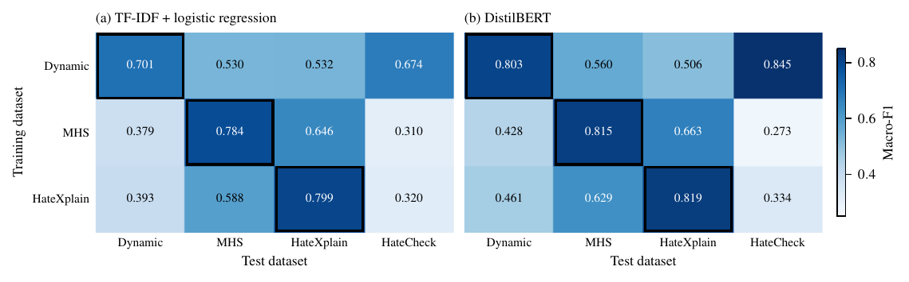
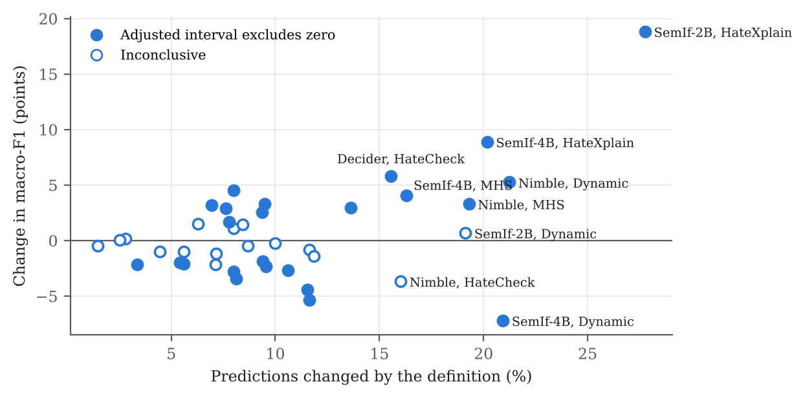
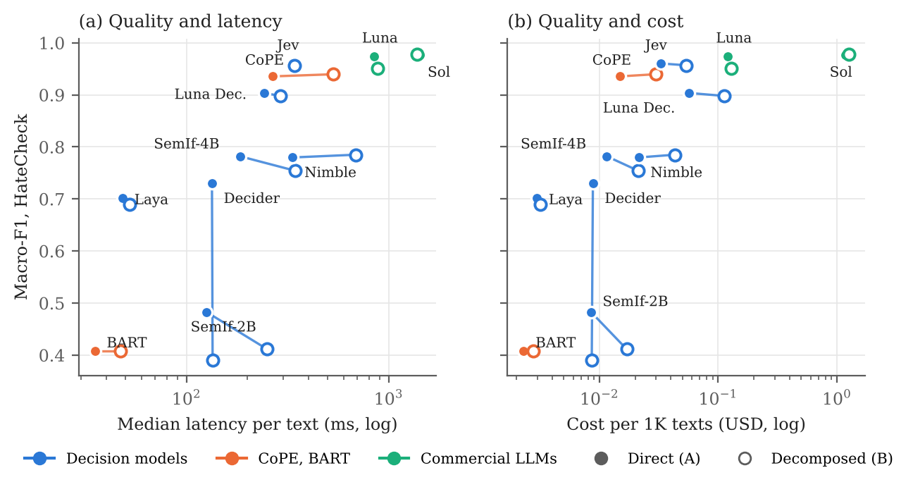
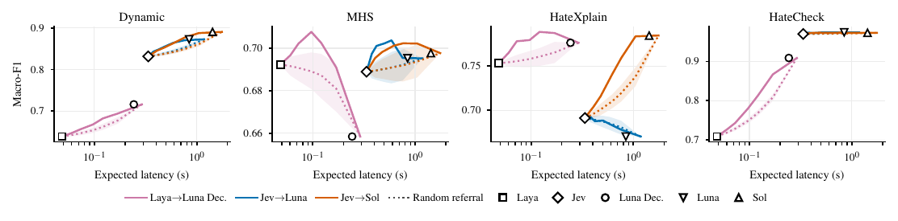
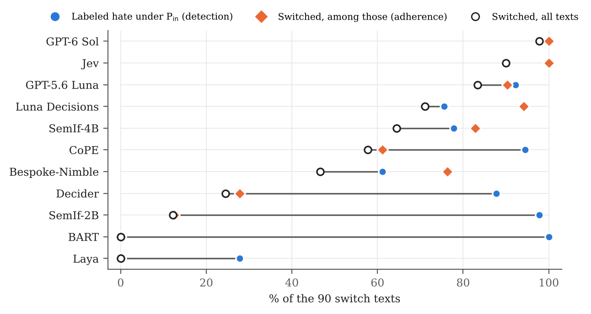

This supplement accompanies the anonymous repository of the paper. It reports the tables, experiments and figures that the page limit excludes, and closes each section with what the results show. Section numbers and appendix letters refer to the submitted paper. All numbers are computed from the cached outputs in the repository, and no result here required new inference.

# S0 Reading Guide

**Conditions.** *No def.* gives the label names only. *Generic* adds one generic definition written for this study. *Bench.* (benchmark-direct) adds the dataset-specific definition and class descriptions. *A* (direct) and *B* (decomposed) add the fixed rule and the glossary of component questions, and differ only in the requested decision. *A\** and *B\** tune the direct threshold or the component thresholds on 200 labeled validation texts. *Soft* multiplies the component scores and tunes one threshold on the same texts.

**Statistics.** Macro-F1 is written as .xxx and differences in percentage points. Intervals come from the paired cluster bootstrap of Section 3.4 (10,000 draws, seed 20260929), with Bonferroni adjustment within the stated family. **Bold** differences have an adjusted 95% interval that excludes zero. The paper calls these significant, and calls the others inconclusive.

**Model names.** Luna is GPT-5.6 Luna and Sol is GPT-6 Sol. Luna Decisions is a separate decision model. Nimble is Bespoke-Nimble.

**Table S0.** Where each part of the supplement belongs in the paper, and what is new.

| Section | Paper | Content not in the paper |
|---|---|---|
| S1 Classification | 4.1, Table 2 | All five prompt conditions, hate precision and recall |
| S2 Generic definition | none | Effect of a generic definition |
| S3 Three-class task | 4.1 | Per-class F1 and offensive-language confusions |
| S4 Transfer and attributes | 4.1, 4.3, App. D | Transfer heatmap, per-class conduct and group F1 |
| S5 Definition effects | 4.2, Fig. 2 | Intervals, changed, corrected and broken predictions |
| S6 Ablation | 4.2, App. E | All 80 contrasts |
| S7 Prompt robustness | 4.2, App. F | Changed predictions and paraphrase wording |
| S8 Decomposition | 4.3, App. G | All 44 cells, soft rule, thresholds, corrected pairs, refusals |
| S9 Efficiency | 4.4, App. H | Latency and cost for every model and dataset |
| S10 Cascades | 4.4, App. I | All 28 frozen points, latency estimates, live run, routing |
| S11 Audit | 4.2, Table 3, App. J | Rater agreement, both references with intervals, disputed cases |
| S12 Policy contrast | 4.2, Table 3, App. K | Detection and adherence by identity, acceptance sensitivity |
| S13 Decider exposure | 4.1, App. L | Partition sizes and intervals |
| S14 Additional annotators | none | Guardrail annotation attempts |
| S15 Compute and spend | 3, App. C | Hardware and hosted spend |

# S1 Classification under All Prompt Conditions

The paper reports benchmark-direct macro-F1 (Table 2) and the A and B scores of the decomposition analysis. Tables S1a to S1d add the no-definition and generic conditions and the hate precision (P) and recall (R) behind each benchmark-direct score. Labeling every text non-hate scores .310 on Dynamic, .430 on MHS, .409 on HateXplain and .238 on HateCheck.

**Table S1a.** Binary macro-F1 on Dynamic (N = 4,120).

| Model | No def. | Generic | Bench. | Bench. P | Bench. R | A | B |
| --- | ---: | ---: | ---: | ---: | ---: | ---: | ---: |
| Jev | .836 | .836 | .832 | .928 | .752 | .826 | .842 |
| Laya | .683 | .651 | .639 | .787 | .483 | .654 | .533 |
| Decider | .590 | .627 | .623 | .813 | .432 | .585 | .554 |
| SemIf-2B | .577 | .559 | .584 | .617 | .723 | .479 | .536 |
| SemIf-4B | .724 | .641 | .652 | .833 | .474 | .675 | .656 |
| Bespoke-Nimble | .719 | .755 | .772 | .794 | .796 | .742 | .705 |
| Luna Decisions | .719 | .700 | .716 | .954 | .521 | .656 | .763 |
| CoPE | .834 | .827 | .810 | .834 | .821 | .826 | .825 |
| BART | – | .355 | .614 | .650 | .668 | .355 | .393 |
| GPT-5.6 Luna | .856 | – | .873 | .923 | .840 | .858 | .852 |
| GPT-6 Sol | .862 | – | .891 | .946 | .850 | .896 | .895 |

**Table S1b.** Binary macro-F1 on MHS (N = 3,203).

| Model | No def. | Generic | Bench. | Bench. P | Bench. R | A | B |
| --- | ---: | ---: | ---: | ---: | ---: | ---: | ---: |
| Jev | .716 | .687 | .689 | .493 | .619 | .689 | .681 |
| Laya | .681 | .688 | .692 | .486 | .671 | .694 | .733 |
| Decider | .804 | .758 | .794 | .615 | .830 | .800 | .707 |
| SemIf-2B | .454 | .629 | .442 | .302 | .980 | .220 | .579 |
| SemIf-4B | .684 | .658 | .725 | .542 | .671 | .718 | .683 |
| Bespoke-Nimble | .583 | .552 | .616 | .385 | .740 | .585 | .551 |
| Luna Decisions | .668 | .588 | .658 | .591 | .366 | .608 | .581 |
| CoPE | .672 | .638 | .653 | .431 | .655 | .676 | .667 |
| BART | – | .197 | .587 | .365 | .855 | .196 | .196 |
| GPT-5.6 Luna | .729 | – | .695 | .507 | .611 | .692 | .628 |
| GPT-6 Sol | .719 | – | .698 | .564 | .510 | .682 | .682 |

**Table S1c.** Binary macro-F1 on HateXplain (N = 1,924). †Generic was run only on the first 1,000 test posts in early experiments.

| Model | No def. | Generic | Bench. | Bench. P | Bench. R | A | B |
| --- | ---: | ---: | ---: | ---: | ---: | ---: | ---: |
| Jev | .646 | .691† | .691 | .505 | .916 | .721 | .713 |
| Laya | .727 | .746† | .753 | .581 | .867 | .722 | .768 |
| Decider | .664 | .612† | .610 | .435 | .833 | .656 | .687 |
| SemIf-2B | .359 | .595† | .548 | .387 | .781 | .418 | .444 |
| SemIf-4B | .603 | .688† | .692 | .520 | .759 | .675 | .677 |
| Bespoke-Nimble | .480 | .467† | .459 | .365 | .973 | .512 | .529 |
| Luna Decisions | .790 | .774† | .776 | .671 | .722 | .775 | .745 |
| CoPE | .606 | .575† | .587 | .426 | .978 | .634 | .632 |
| BART | – | – | .516 | .373 | .833 | .240 | .242 |
| GPT-5.6 Luna | .655 | – | .670 | .485 | .951 | .663 | .611 |
| GPT-6 Sol | .755 | – | .784 | .641 | .825 | .768 | .719 |

**Table S1d.** Binary macro-F1 on HateCheck (N = 3,728).

| Model | No def. | Generic | Bench. | Bench. P | Bench. R | A | B |
| --- | ---: | ---: | ---: | ---: | ---: | ---: | ---: |
| Jev | .968 | .968 | .970 | .995 | .966 | .960 | .957 |
| Laya | .737 | .714 | .709 | .845 | .751 | .701 | .690 |
| Decider | .722 | .776 | .781 | .870 | .849 | .730 | .390 |
| SemIf-2B | .641 | .685 | .656 | .761 | .936 | .483 | .411 |
| SemIf-4B | .794 | .779 | .786 | .881 | .838 | .782 | .754 |
| Bespoke-Nimble | .822 | .824 | .785 | .858 | .882 | .780 | .785 |
| Luna Decisions | .877 | .831 | .909 | .994 | .885 | .904 | .898 |
| CoPE | .934 | .917 | .913 | .922 | .978 | .936 | .940 |
| BART | – | .407 | .729 | .807 | .905 | .407 | .407 |
| GPT-5.6 Luna | .974 | – | .974 | .998 | .969 | .974 | .950 |
| GPT-6 Sol | .977 | – | .973 | 1.000 | .966 | .976 | .978 |

BART scores whether a text supports a sentence, so it has no separate no-definition run, and its benchmark-direct run is the policy-free baseline. Once the sentence contains a definition (Generic, A, B), BART labels almost every text hate, with hate recall of .96 to 1.00, and its macro-F1 falls to the level of labeling every text hate. The commercial LLMs were not run with the generic definition.

**What this shows.** Precision and recall explain several rankings in Table 2. On MHS, Decider combines the highest precision among the decision models (.615) with high recall (.830), whereas SemIf-2B reaches .980 recall at .302 precision, so it labels most comments hate. On Dynamic, Luna Decisions is the most precise decision model (.954) but recalls only .521. The prompt condition reorders models on every dataset, so no single prompt gives a stable ranking.

# S2 Generic Definition

Early experiments gave every dataset the same generic definition (repository, `prompts/definitions.md`). No dataset is annotated under it, so agreement with the labels cannot show whether a model applies it correctly, and the paper leaves it out. Table S2 reports its effect without significance tests.

**Table S2.** Change in binary macro-F1 (points) from adding the generic definition to the no-definition prompt. HateXplain uses the first 1,000 test posts.

| Model | Dynamic | MHS | HateXplain | HateCheck |
| --- | ---: | ---: | ---: | ---: |
| Jev | −0.1 | −2.9 | +5.3 | +0.0 |
| Laya | −3.2 | +0.6 | +2.5 | −2.3 |
| Decider | +3.6 | −4.7 | −3.3 | +5.4 |
| SemIf-2B | −1.9 | +17.5 | +23.6 | +4.4 |
| SemIf-4B | −8.3 | −2.6 | +11.0 | −1.4 |
| Bespoke-Nimble | +3.6 | −3.1 | −0.4 | +0.3 |
| Luna Decisions | −1.9 | −8.1 | – | −4.6 |
| CoPE | −0.7 | −3.4 | −2.5 | −1.7 |

**What this shows.** A definition no dataset was annotated under still moves macro-F1 by up to 23.6 points, in both directions, and the sign changes with the model and dataset. The definition-dependence of Section 4.2 is therefore not specific to the dataset-specific definitions.

# S3 Three-Class Task on HateXplain

**Table S3.** HateXplain three-class results under benchmark-direct classification (1,924 posts, 594 hate, 548 offensive, 782 normal). F1 and recall (R) per class, and the share of offensive posts labeled hate or normal. The supervised classifiers are trained on a 5,000-post subset of the training partition.

| Model | Macro-F1 | F1 hate | F1 off. | F1 normal | R hate | R off. | Off.→hate % | Off.→normal % |
| --- | ---: | ---: | ---: | ---: | ---: | ---: | ---: | ---: |
| Jev | .544 | .663 | .381 | .587 | .880 | .358 | 52 | 12 |
| Laya | .582 | .707 | .346 | .693 | .889 | .257 | 41 | 34 |
| Decider | .511 | .616 | .405 | .512 | .677 | .489 | 37 | 14 |
| SemIf-2B | .277 | .518 | .312 | .003 | .822 | .336 | 66 | 0 |
| SemIf-4B | .401 | .570 | .213 | .421 | .912 | .170 | 75 | 8 |
| Bespoke-Nimble | .375 | .543 | .266 | .315 | .960 | .192 | 78 | 3 |
| Luna Decisions | .615 | .698 | .468 | .677 | .727 | .507 | 26 | 23 |
| CoPE | .253 | .561 | .194 | .005 | .990 | .172 | 83 | 0 |
| BART | .271 | .496 | .174 | .145 | .896 | .130 | 84 | 3 |
| GPT-5.6 Luna | .519 | .666 | .368 | .522 | .916 | .367 | 56 | 8 |
| GPT-6 Sol | .616 | .710 | .464 | .674 | .843 | .453 | 37 | 17 |
| TF-IDF+LR | .642 | .736 | .471 | .717 | .722 | .412 | 16 | 43 |
| DistilBERT | .637 | .733 | .450 | .728 | .791 | .389 | 28 | 33 |

**What this shows.** Most models score lowest on the offensive class, and the out-of-the-box models move offensive posts mostly into hate. The decision models label 26% (Luna Decisions) to 78% (Bespoke-Nimble) of offensive posts hate, against 16% and 28% for the supervised classifiers, which instead confuse offensive with normal. Offensive-class F1 reaches at most .468 for the out-of-the-box models (Luna Decisions) and .471 for TF-IDF+LR. Separating offensive language from hate-speech is the weakest point of moderation by prompt.

# S4 Cross-Dataset Transfer and Attributes

**Figure S1.** Macro-F1 of the supervised classifiers trained on one dataset (rows) and tested on each dataset (columns). Boxes mark the in-domain score.

**Table S4a.** Selected hyperparameters of the supervised classifiers, chosen on source-validation macro-F1.

| Classifier | Trained on | Selected | Validation macro-F1 |
| --- | --- | --- | ---: |
| DistilBERT | Dynamic | epoch 3 | .833 |
| DistilBERT | HateXplain | epoch 2 | .828 |
| DistilBERT | MHS | epoch 2 | .823 |
| TF-IDF+LR | Dynamic | C = 1 | .750 |
| TF-IDF+LR | HateXplain | C = 10 | .797 |
| TF-IDF+LR | MHS | C = 10 | .789 |

**Table S4b.** Attribute macro-F1 without a definition and with the dataset-specific definition (benchmark-direct). Group is HateCheck's referenced group (seven classes), direction is general or directed hate, and conduct is Dynamic's conduct type (six classes). The supervised classifiers are trained on Dynamic's conduct labels. CoPE and Sol were not run on attributes.

| Model | Group, no def. | Direction, no def. | Conduct, no def. | Group, Bench. | Direction, Bench. | Conduct, Bench. |
| --- | ---: | ---: | ---: | ---: | ---: | ---: |
| Jev | .989 | .324 | .306 | .989 | .682 | .538 |
| Laya | .936 | .613 | .179 | .929 | .694 | .192 |
| Decider | .962 | .420 | .284 | .959 | .610 | .313 |
| SemIf-2B | .952 | .399 | .169 | .939 | .269 | .196 |
| SemIf-4B | .968 | .298 | .176 | .962 | .594 | .406 |
| Bespoke-Nimble | .971 | .351 | .240 | .971 | .567 | .324 |
| Luna Decisions | .991 | .655 | .362 | .992 | .631 | .535 |
| BART | – | – | – | .166 | .441 | .119 |
| GPT-5.6 Luna | .996 | .723 | .348 | .998 | .704 | .519 |
| TF-IDF+LR | – | – | – | – | – | .274 |
| DistilBERT | – | – | – | – | – | .474 |

**Table S4c.** Conduct-type F1 per class on Dynamic under benchmark-direct classification. Column headers give each class's share of the 3,356 test texts.

| Model | none (55.2%) | animosity (9.4%) | derogation (30.9%) | dehumanization (2.1%) | threatening (1.4%) | support (1.0%) |
| --- | ---: | ---: | ---: | ---: | ---: | ---: |
| Jev | .854 | .276 | .667 | .388 | .423 | .621 |
| Laya | .575 | .152 | .242 | .013 | .159 | .011 |
| Decider | .554 | .157 | .497 | .252 | .294 | .126 |
| SemIf-2B | .220 | .198 | .347 | .213 | .116 | .083 |
| SemIf-4B | .645 | .136 | .579 | .304 | .333 | .435 |
| Bespoke-Nimble | .542 | .222 | .615 | .195 | .202 | .166 |
| Luna Decisions | .832 | .299 | .588 | .367 | .517 | .606 |
| BART | .711 | .000 | .000 | .000 | .000 | .000 |
| GPT-5.6 Luna | .857 | .193 | .711 | .345 | .435 | .575 |
| TF-IDF+LR | .723 | .132 | .517 | .136 | .136 | .000 |
| DistilBERT | .803 | .075 | .654 | .472 | .480 | .360 |

**Table S4d.** Referenced-group F1 per class on HateCheck under benchmark-direct classification.

| Model | women | trans people | gay people | black people | disabled people | Muslims | immigrants |
| --- | ---: | ---: | ---: | ---: | ---: | ---: | ---: |
| Jev | .985 | .996 | .994 | .995 | .978 | .991 | .982 |
| Laya | .955 | .880 | .886 | .925 | .947 | .942 | .965 |
| Decider | .956 | .980 | .949 | .947 | .955 | .959 | .964 |
| SemIf-2B | .825 | .976 | .948 | .966 | .949 | .947 | .963 |
| SemIf-4B | .927 | .978 | .973 | .987 | .970 | .952 | .942 |
| Bespoke-Nimble | .984 | .985 | .935 | .988 | .968 | .959 | .976 |
| Luna Decisions | .994 | .998 | .995 | .996 | .993 | .988 | .980 |
| BART | .086 | .574 | .344 | .072 | .072 | .012 | .000 |
| GPT-5.6 Luna | .998 | 1.000 | .997 | .996 | .998 | 1.000 | .995 |

**What this shows.** The supervised classifiers reach .70 to .82 in domain but lose up to 54 points elsewhere, and only training on Dynamic transfers to HateCheck. Within attributes, the decision models nearly solve group identification (.929 to .992), but not conduct. The three rare conduct classes (dehumanization, threatening, support) cover 4.5% of texts, and Jev is the only model above .38 on all three. Adding the definition raises conduct macro-F1 for every model with both runs and direction macro-F1 for five of eight, by up to 36 points (Jev, direction). This exceeds every binary effect in Table S5, so the definition matters more for attributes than for the binary task.

# S5 Definition Effects

The paper reports the 28 primary comparisons as a figure (Figure 2) and summarizes the changed predictions in one sentence. Table S5 gives every comparison with its adjusted interval and the predictions the definition changes, corrects and breaks. A corrected prediction is wrong without the definition and right with it, and a broken one the reverse. The family column gives the Bonferroni family size. Luna Decisions, Luna and Sol form separate families of 4 because they were added after the primary analysis.

**Table S5.** Benchmark-direct minus no-definition macro-F1 on the full test sets.

| Model | Dataset | No def. | Bench. | ΔF1 | Adjusted 95% CI | Changed % | Corrected % | Broken % | Family |
| --- | --- | ---: | ---: | ---: | ---: | ---: | ---: | ---: | ---: |
| Jev | Dynamic | .836 | .832 | −0.5 | [−1.9, +1.0] | 8.7 | 4.1 | 4.6 | 28 |
|  | MHS | .716 | .689 | **−2.7** | [−4.8, −0.6] | 10.6 | 5.2 | 5.4 | 28 |
|  | HateXplain | .646 | .691 | **+4.5** | [+2.7, +6.3] | 8.0 | 6.4 | 1.6 | 28 |
|  | HateCheck | .968 | .970 | +0.1 | [−1.7, +1.6] | 2.8 | 1.4 | 1.4 | 28 |
| Laya | Dynamic | .683 | .639 | **−4.4** | [−6.1, −2.8] | 11.6 | 3.8 | 7.8 | 28 |
|  | MHS | .681 | .692 | +1.1 | [−0.7, +2.9] | 8.0 | 5.1 | 2.9 | 28 |
|  | HateXplain | .727 | .753 | **+2.6** | [+0.4, +4.6] | 9.4 | 6.2 | 3.1 | 28 |
|  | HateCheck | .737 | .709 | **−2.8** | [−5.0, −0.6] | 8.0 | 2.5 | 5.5 | 28 |
| Decider | Dynamic | .590 | .623 | **+3.3** | [+1.7, +5.0] | 9.5 | 6.1 | 3.4 | 28 |
|  | MHS | .804 | .794 | −1.0 | [−2.4, +0.4] | 4.5 | 1.8 | 2.7 | 28 |
|  | HateXplain | .664 | .610 | **−5.4** | [−7.6, −3.1] | 11.6 | 2.8 | 8.8 | 28 |
|  | HateCheck | .722 | .781 | **+5.8** | [+1.8, +10.3] | 15.6 | 11.4 | 4.1 | 28 |
| SemIf-2B | Dynamic | .577 | .584 | +0.7 | [−1.5, +3.0] | 19.1 | 7.9 | 11.2 | 28 |
|  | MHS | .454 | .442 | −1.2 | [−2.8, +0.3] | 7.1 | 3.0 | 4.2 | 28 |
|  | HateXplain | .359 | .548 | **+18.8** | [+15.4, +22.3] | 27.8 | 22.0 | 5.8 | 28 |
|  | HateCheck | .641 | .656 | +1.5 | [−1.8, +5.2] | 6.3 | 2.8 | 3.5 | 28 |
| SemIf-4B | Dynamic | .724 | .652 | **−7.2** | [−9.3, −5.1] | 20.9 | 7.1 | 13.8 | 28 |
|  | MHS | .684 | .725 | **+4.1** | [+1.7, +6.5] | 16.3 | 11.6 | 4.7 | 28 |
|  | HateXplain | .603 | .692 | **+8.9** | [+5.9, +11.9] | 20.2 | 15.4 | 4.8 | 28 |
|  | HateCheck | .794 | .786 | −0.8 | [−4.0, +2.5] | 11.6 | 4.6 | 7.1 | 28 |
| Bespoke-Nimble | Dynamic | .719 | .772 | **+5.3** | [+2.8, +7.6] | 21.2 | 12.5 | 8.8 | 28 |
|  | MHS | .583 | .616 | **+3.3** | [+1.1, +5.7] | 19.3 | 12.6 | 6.7 | 28 |
|  | HateXplain | .480 | .459 | −2.1 | [−4.2, +0.0] | 7.1 | 2.7 | 4.5 | 28 |
|  | HateCheck | .822 | .785 | −3.7 | [−9.1, +1.1] | 16.0 | 5.7 | 10.3 | 28 |
| Luna Decisions | Dynamic | .718 | .716 | −0.2 | [−1.6, +1.0] | 10.0 | 4.9 | 5.1 | 4 |
|  | MHS | .668 | .658 | −1.0 | [−2.8, +0.8] | 5.6 | 2.0 | 3.6 | 4 |
|  | HateXplain | .790 | .776 | −1.4 | [−3.6, +0.8] | 11.9 | 5.7 | 6.1 | 4 |
|  | HateCheck | .877 | .909 | **+3.2** | [+1.7, +4.8] | 6.9 | 5.0 | 1.9 | 4 |
| CoPE | Dynamic | .834 | .810 | **−2.3** | [−3.8, −0.9] | 9.5 | 3.6 | 5.9 | 28 |
|  | MHS | .672 | .653 | **−1.9** | [−3.8, −0.1] | 9.4 | 4.1 | 5.3 | 28 |
|  | HateXplain | .606 | .587 | **−2.0** | [−3.7, −0.4] | 5.4 | 1.7 | 3.7 | 28 |
|  | HateCheck | .934 | .913 | **−2.1** | [−4.1, −0.7] | 3.4 | 0.8 | 2.5 | 28 |
| GPT-5.6 Luna | Dynamic | .856 | .873 | **+1.7** | [+0.6, +2.7] | 7.8 | 4.7 | 3.1 | 4 |
|  | MHS | .729 | .695 | **−3.4** | [−4.9, −2.0] | 8.1 | 2.8 | 5.3 | 4 |
|  | HateXplain | .655 | .670 | +1.5 | [−0.1, +3.1] | 8.4 | 5.0 | 3.4 | 4 |
|  | HateCheck | .974 | .974 | +0.0 | [−1.1, +1.1] | 2.5 | 1.3 | 1.3 | 4 |
| GPT-6 Sol | Dynamic | .862 | .891 | **+2.9** | [+1.8, +4.0] | 7.6 | 5.3 | 2.4 | 4 |
|  | MHS | .719 | .698 | **−2.1** | [−3.5, −0.6] | 5.6 | 2.0 | 3.6 | 4 |
|  | HateXplain | .755 | .784 | **+3.0** | [+0.9, +5.0] | 13.6 | 8.8 | 4.8 | 4 |
|  | HateCheck | .977 | .973 | −0.5 | [−1.2, +0.2] | 1.5 | 0.5 | 0.9 | 4 |

**Figure S2.** Change in macro-F1 against the share of predictions the definition changes. Filled markers have adjusted intervals that exclude zero.

**What this shows.** In the primary family, 9 comparisons are significant gains, 9 significant losses and 10 inconclusive. Macro-F1 understates how much a definition changes. Corrected and broken predictions offset each other, so SemIf-2B on Dynamic changes 19.1% of its predictions for a gain of 0.7 points, and Bespoke-Nimble on HateCheck changes 16.0% for an inconclusive loss. The largest net gains, for SemIf-2B and SemIf-4B on HateXplain, also come with the most changes. A platform cannot read a stable macro-F1 as evidence that a model ignores the definition.

# S6 Definition and Class-Description Ablation

The paper reports the ablation counts (Appendix E). Table S6 lists every contrast. C1 is the label-only prompt, C2 adds the definition, and C3 adds the class descriptions, which gives the benchmark-direct prompt. Scores are on texts valid under all three prompts. The nine decision and commercial models form one family of 72 contrasts and CoPE a family of 8.

**Table S6.** Ablation macro-F1 and adjusted differences (points).

| Model | Dataset | C1 | C2 | C3 | C2−C1 | Adjusted CI | C3−C2 | Adjusted CI |
| --- | --- | ---: | ---: | ---: | ---: | ---: | ---: | ---: |
| Jev | Dynamic | .815 | .835 | .832 | +2.0 | [−0.0, +3.9] | −0.3 | [−1.0, +0.3] |
|  | MHS | .687 | .704 | .689 | +1.7 | [−0.5, +4.1] | −1.5 | [−3.3, +0.1] |
|  | HateXplain | .643 | .686 | .691 | **+4.3** | [+2.4, +6.3] | +0.5 | [−0.6, +1.7] |
|  | HateCheck | .951 | .973 | .970 | +2.1 | [−0.4, +4.1] | −0.3 | [−0.7, +0.0] |
| Laya | Dynamic | .680 | .623 | .639 | **−5.8** | [−7.8, −3.8] | **+1.6** | [+0.4, +2.9] |
|  | MHS | .677 | .701 | .692 | **+2.3** | [+0.2, +4.4] | −0.8 | [−2.4, +0.6] |
|  | HateXplain | .718 | .753 | .753 | **+3.5** | [+1.5, +5.6] | −0.0 | [−1.3, +1.2] |
|  | HateCheck | .744 | .717 | .709 | **−2.8** | [−5.5, −0.1] | −0.8 | [−2.1, +0.5] |
| Decider | Dynamic | .649 | .610 | .623 | **−3.9** | [−5.9, −2.1] | **+1.3** | [+0.4, +2.3] |
|  | MHS | .750 | .812 | .794 | **+6.2** | [+3.9, +8.6] | **−1.8** | [−3.2, −0.4] |
|  | HateXplain | .626 | .596 | .610 | **−3.0** | [−4.9, −1.1] | +1.4 | [−0.1, +2.9] |
|  | HateCheck | .763 | .769 | .781 | +0.7 | [−2.5, +3.7] | +1.1 | [−0.3, +2.6] |
| SemIf-2B | Dynamic | .503 | .590 | .584 | **+8.8** | [+5.7, +11.9] | −0.6 | [−1.7, +0.4] |
|  | MHS | .664 | .390 | .442 | **−27.3** | [−31.0, −23.3] | **+5.2** | [+3.7, +6.8] |
|  | HateXplain | .586 | .486 | .548 | **−10.0** | [−13.1, −6.9] | **+6.2** | [+4.0, +8.7] |
|  | HateCheck | .619 | .696 | .656 | +7.7 | [−1.1, +16.7] | **−4.0** | [−6.8, −1.7] |
| SemIf-4B | Dynamic | .690 | .687 | .652 | −0.2 | [−2.9, +2.4] | **−3.6** | [−4.9, −2.2] |
|  | MHS | .610 | .723 | .725 | **+11.3** | [+8.6, +14.0] | +0.2 | [−1.7, +2.0] |
|  | HateXplain | .571 | .645 | .692 | **+7.4** | [+4.8, +10.1] | **+4.7** | [+2.1, +7.3] |
|  | HateCheck | .785 | .799 | .786 | +1.5 | [−2.1, +5.3] | −1.4 | [−4.6, +1.8] |
| Bespoke-Nimble | Dynamic | .701 | .775 | .772 | **+7.3** | [+4.8, +9.9] | −0.3 | [−1.8, +1.3] |
|  | MHS | .592 | .604 | .616 | +1.2 | [−0.6, +3.0] | +1.2 | [−0.7, +3.3] |
|  | HateXplain | .463 | .463 | .459 | −0.0 | [−2.2, +2.1] | −0.4 | [−2.2, +1.3] |
|  | HateCheck | .812 | .818 | .785 | +0.6 | [−3.3, +4.2] | −3.3 | [−7.6, +0.4] |
| Luna Decisions | Dynamic | .807 | .696 | .716 | **−11.1** | [−13.3, −9.1] | **+2.0** | [+0.4, +3.4] |
|  | MHS | .724 | .666 | .658 | **−5.8** | [−8.8, −2.9] | −0.7 | [−2.8, +1.2] |
|  | HateXplain | .790 | .793 | .776 | +0.3 | [−2.2, +3.0] | −1.6 | [−4.4, +0.8] |
|  | HateCheck | .948 | .906 | .911 | **−4.2** | [−8.8, −1.1] | +0.5 | [−0.5, +1.6] |
| CoPE | Dynamic | .834 | .813 | .810 | **−2.1** | [−3.4, −0.8] | −0.2 | [−0.9, +0.4] |
|  | MHS | .672 | .650 | .653 | **−2.2** | [−3.6, −0.8] | +0.3 | [−0.8, +1.4] |
|  | HateXplain | .606 | .599 | .587 | −0.7 | [−2.0, +0.6] | **−1.3** | [−2.3, −0.3] |
|  | HateCheck | .934 | .921 | .913 | **−1.3** | [−2.6, −0.2] | **−0.9** | [−1.7, −0.3] |
| GPT-5.6 Luna | Dynamic | .857 | .876 | .873 | **+1.9** | [+0.3, +3.6] | −0.4 | [−1.5, +0.7] |
|  | MHS | .719 | .712 | .695 | −0.7 | [−3.1, +1.7] | −1.7 | [−3.6, +0.0] |
|  | HateXplain | .680 | .656 | .670 | **−2.4** | [−4.6, −0.4] | +1.4 | [−0.5, +3.3] |
|  | HateCheck | .969 | .978 | .974 | +0.8 | [−1.4, +2.5] | −0.4 | [−1.3, +0.7] |
| GPT-6 Sol | Dynamic | .861 | .898 | .891 | **+3.6** | [+2.1, +5.0] | −0.7 | [−1.8, +0.3] |
|  | MHS | .714 | .699 | .698 | −1.5 | [−3.5, +0.6] | −0.1 | [−2.0, +1.7] |
|  | HateXplain | .791 | .783 | .784 | −0.8 | [−2.9, +1.3] | +0.1 | [−1.9, +2.0] |
|  | HateCheck | .976 | .979 | .973 | +0.3 | [−0.6, +1.2] | −0.6 | [−1.5, +0.1] |

**What this shows.** In the main family, the definition (C2 − C1) gives 10 significant gains and 10 losses in 36 contrasts, and the class descriptions (C3 − C2) 6 gains and 3 losses. The largest effects follow the definition, such as −27.3 points for SemIf-2B and +11.3 for SemIf-4B on MHS, and −11.1 for Luna Decisions on Dynamic. The class descriptions mostly move macro-F1 by less than two points, and partly reverse the definition's effect for SemIf-2B on MHS and HateXplain. CoPE loses with the definition on three datasets, consistent with its losses in Section 4.2.

# S7 Prompt Robustness

The paper reports the macro-F1 changes (Appendix F, Table 4). Table S7a adds the share of changed predictions and Table S7b their direction. Option-label variants rename the options to A and B (A/B) or reverse their order (Rev.), in a family of 10 contrasts. The paraphrases P1 and P2 replace the MHS definition, in a family of 20. All variants run on MHS under benchmark-direct classification.

**Table S7a.** Change in MHS macro-F1 (points) and share of changed predictions (%).

| Model | Orig. | A/B Δ | A/B chg. % | Rev. Δ | Rev. chg. % | P1 Δ | P1 chg. % | P2 Δ | P2 chg. % |
| --- | ---: | ---: | ---: | ---: | ---: | ---: | ---: | ---: | ---: |
| Laya | .692 | **−25.2** | 44.5 | +0.7 | 5.5 | −0.4 | 2.7 | −0.4 | 1.9 |
| Decider | .794 | −0.1 | 3.5 | +0.6 | 2.0 | −0.8 | 3.0 | **−1.1** | 2.4 |
| SemIf-2B | .442 | **−1.9** | 8.1 | **−5.7** | 6.9 | **−1.3** | 3.8 | **−1.6** | 2.8 |
| SemIf-4B | .725 | **−3.3** | 11.1 | +1.0 | 4.7 | −1.2 | 4.8 | +0.3 | 3.7 |
| Bespoke-Nimble | .616 | −0.5 | 9.2 | **+5.2** | 21.9 | **−2.0** | 7.9 | −1.2 | 6.1 |
| Jev | .689 | – | – | – | – | +0.4 | 3.3 | +0.6 | 2.5 |
| Luna Decisions | .658 | – | – | – | – | −1.0 | 3.8 | −0.3 | 4.4 |
| CoPE | .653 | – | – | – | – | −0.1 | 2.2 | −0.4 | 2.3 |
| GPT-5.6 Luna | .695 | – | – | – | – | +0.7 | 5.6 | +0.8 | 5.2 |
| GPT-6 Sol | .698 | – | – | – | – | −1.4 | 4.2 | −0.1 | 4.2 |

**Table S7b.** Changed predictions per variant, split into corrected and introduced false positives (FP) and false negatives (FN).

| Model | Variant | Changed | Corr. FP | Corr. FN | Intr. FP | Intr. FN |
| --- | --- | ---: | ---: | ---: | ---: | ---: |
| Laya | A/B | 1424 | 418 | 40 | 521 | 445 |
| Laya | Rev. | 177 | 68 | 31 | 54 | 24 |
| Laya | P1 | 86 | 23 | 13 | 36 | 14 |
| Laya | P2 | 60 | 15 | 9 | 24 | 12 |
| Decider | A/B | 112 | 57 | 4 | 19 | 32 |
| Decider | Rev. | 64 | 44 | 1 | 4 | 15 |
| Decider | P1 | 97 | 24 | 13 | 41 | 19 |
| Decider | P2 | 76 | 4 | 15 | 50 | 7 |
| SemIf-2B | A/B | 260 | 97 | 4 | 150 | 9 |
| SemIf-2B | Rev. | 222 | 18 | 9 | 195 | 0 |
| SemIf-2B | P1 | 122 | 36 | 6 | 78 | 2 |
| SemIf-2B | P2 | 89 | 17 | 3 | 68 | 1 |
| SemIf-4B | A/B | 354 | 188 | 0 | 7 | 159 |
| SemIf-4B | Rev. | 152 | 21 | 56 | 69 | 6 |
| SemIf-4B | P1 | 153 | 54 | 11 | 49 | 39 |
| SemIf-4B | P2 | 119 | 42 | 23 | 31 | 23 |
| Bespoke-Nimble | A/B | 296 | 159 | 7 | 39 | 91 |
| Bespoke-Nimble | Rev. | 702 | 519 | 0 | 1 | 182 |
| Bespoke-Nimble | P1 | 253 | 75 | 20 | 116 | 42 |
| Bespoke-Nimble | P2 | 194 | 31 | 35 | 122 | 6 |
| Jev | P1 | 106 | 49 | 14 | 22 | 21 |
| Jev | P2 | 80 | 33 | 16 | 20 | 11 |
| Luna Decisions | P1 | 122 | 38 | 18 | 31 | 35 |
| Luna Decisions | P2 | 141 | 31 | 34 | 42 | 34 |
| CoPE | P1 | 71 | 22 | 9 | 37 | 3 |
| CoPE | P2 | 74 | 36 | 0 | 21 | 17 |
| GPT-5.6 Luna | P1 | 180 | 90 | 17 | 42 | 31 |
| GPT-5.6 Luna | P2 | 167 | 66 | 27 | 58 | 16 |
| GPT-6 Sol | P1 | 133 | 57 | 7 | 19 | 50 |
| GPT-6 Sol | P2 | 133 | 49 | 23 | 24 | 37 |

The paraphrases were frozen before inference, and only the definition paragraph differs from the benchmark-direct MHS prompt.

> **Original.** Hate speech is prejudice-driven, hostile or malicious language directed at a person or group because of actual or perceived innate characteristics, particularly when the group is unnecessarily labeled. Assess whether the comment contains hate speech under this definition; the available judgments are yes, no, and unclear.
>
> **P1 (reordered clauses).** Language is hate speech when it targets a person or group because of their actual or perceived innate characteristics and is driven by prejudice and hostile or malicious, especially when it labels the group without need. Decide whether the comment contains hate speech under this definition; the possible judgments are yes, no, and unclear.
>
> **P2 (synonyms).** Hate speech is language motivated by prejudice that is hostile or malicious toward a person or group on the basis of real or assumed innate traits, in particular where the group is labeled needlessly. Determine whether the comment includes hate speech according to this definition; the judgments available are yes, no, and unclear.

Model rankings correlate at Spearman ρ of .90 (original and P1), .98 (original and P2) and .95 (P1 and P2).

**What this shows.** Option names matter far more than definition wording. Renaming the options changes 44.5% of Laya's predictions, and reversing them 21.9% of Bespoke-Nimble's, while the paraphrases change at most 7.9% of any model's predictions. The paraphrases still change 1.9% to 7.9% of predictions, about as many as some dataset-specific definitions in Table S5, so part of each definition effect may reflect wording rather than content.

# S8 Decomposition

## S8.1 All Direct and Decomposed Comparisons

The paper summarizes 44 comparisons of direct (A) and decomposed (B) classification (Table 2, Figure 4). Table S8a lists them. Dynamic, MHS and HateXplain form the primary family of 30 contrasts, HateCheck a family of 10 and Luna Decisions a family of 4 on texts it answered under both conditions. ΔP and ΔR give the change in hate precision and recall in points. § marks the 3 comparisons in which A or B scores below labeling every text non-hate.

**Table S8a.** Decomposed minus direct macro-F1 on the same texts and definition.

| Model | Dataset | N | A | B | B−A | Adjusted 95% CI | ΔP | ΔR |
| --- | --- | ---: | ---: | ---: | ---: | ---: | ---: | ---: |
| Jev | Dynamic | 4,120 | .826 | .842 | **+1.6** | [+0.5, +2.8] | −1.2 | +4.2 |
| Laya | Dynamic | 4,120 | .654 | .533 | **−12.1** | [−14.4, −9.8] | +4.6 | −27.1 |
| Decider | Dynamic | 4,120 | .585 | .554 | **−3.2** | [−5.3, −1.0] | +1.5 | −6.0 |
| SemIf-2B | Dynamic | 4,120 | .479 | .536 | **+5.7** | [+2.7, +8.7] | +1.2 | −38.3 |
| SemIf-4B | Dynamic | 4,120 | .675 | .656 | **−2.0** | [−3.6, −0.3] | +0.4 | −4.7 |
| Bespoke-Nimble | Dynamic | 4,120 | .742 | .705 | **−3.7** | [−5.5, −1.9] | −2.6 | −3.5 |
| Luna Decisions | Dynamic | 4,098 | .656 | .762 | **+10.6** | [+9.0, +12.1] | – | – |
| CoPE | Dynamic | 4,120 | .826 | .825 | −0.2 | [−0.8, +0.4] | +0.6 | −1.2 |
| BART | Dynamic | 4,120 | .355 | .393 | **+3.8** | [+2.2, +5.3] | +0.2 | −3.8 |
| GPT-5.6 Luna | Dynamic | 4,120 | .858 | .852 | −0.6 | [−2.4, +1.2] | −10.4 | +12.3 |
| GPT-6 Sol | Dynamic | 4,120 | .896 | .895 | −0.1 | [−1.4, +1.3] | −5.1 | +5.7 |
| Jev | MHS | 3,203 | .689 | .681 | −0.8 | [−2.0, +0.4] | −1.1 | −1.0 |
| Laya | MHS | 3,203 | .694 | .733 | **+3.9** | [+1.9, +5.9] | +6.0 | −0.8 |
| Decider | MHS | 3,203 | .800 | .707 | **−9.3** | [−12.3, −6.2] | +4.4 | −37.0 |
| SemIf-2B | MHS | 3,203 | .220 | .579 | **+35.9**§ | [+33.3, +38.5] | +10.4 | −25.4 |
| SemIf-4B | MHS | 3,203 | .718 | .683 | **−3.6** | [−5.7, −1.5] | −2.6 | −11.9 |
| Bespoke-Nimble | MHS | 3,203 | .585 | .551 | **−3.4** | [−5.7, −1.1] | −4.4 | −26.0 |
| Luna Decisions | MHS | 3,203 | .608 | .581 | **−2.7** | [−4.5, −0.9] | – | – |
| CoPE | MHS | 3,203 | .676 | .667 | **−0.9** | [−1.7, −0.1] | −0.9 | −1.5 |
| BART | MHS | 3,203 | .196 | .196 | 0.0§ | [0.0, 0.0] | 0.0 | 0.0 |
| GPT-5.6 Luna | MHS | 3,203 | .692 | .628 | **−6.4** | [−8.5, −4.3] | −10.8 | +5.6 |
| GPT-6 Sol | MHS | 3,203 | .682 | .682 | +0.1 | [−2.1, +2.3] | −5.6 | +10.6 |
| Jev | HateXplain | 1,924 | .721 | .713 | −0.8 | [−2.0, +0.4] | −1.2 | +1.3 |
| Laya | HateXplain | 1,924 | .722 | .768 | **+4.6** | [+2.0, +7.4] | +8.4 | −10.4 |
| Decider | HateXplain | 1,924 | .656 | .687 | **+3.1** | [+0.2, +6.0] | +5.1 | −6.7 |
| SemIf-2B | HateXplain | 1,924 | .418 | .444 | +2.6 | [−0.3, +5.7] | −0.0 | −6.6 |
| SemIf-4B | HateXplain | 1,924 | .675 | .677 | +0.3 | [−1.9, +2.4] | +0.8 | −4.4 |
| Bespoke-Nimble | HateXplain | 1,924 | .512 | .529 | +1.7 | [−0.4, +3.6] | +0.5 | −2.7 |
| Luna Decisions | HateXplain | 1,924 | .775 | .745 | **−3.0** | [−4.8, −1.3] | – | – |
| CoPE | HateXplain | 1,924 | .634 | .632 | −0.3 | [−1.0, +0.5] | −0.2 | 0.0 |
| BART | HateXplain | 1,924 | .240 | .242 | +0.2§ | [−0.8, +1.2] | +0.1 | +0.2 |
| GPT-5.6 Luna | HateXplain | 1,924 | .663 | .611 | **−5.2** | [−7.6, −3.0] | −3.9 | +2.0 |
| GPT-6 Sol | HateXplain | 1,924 | .768 | .719 | **−4.9** | [−7.3, −2.4] | −9.2 | +9.4 |
| Jev | HateCheck | 3,728 | .960 | .957 | −0.4 | [−1.5, +0.7] | −0.7 | +0.3 |
| Laya | HateCheck | 3,728 | .701 | .690 | −1.1 | [−4.3, +2.2] | +3.0 | −7.7 |
| Decider | HateCheck | 3,728 | .730 | .390 | **−34.0** | [−38.4, −29.6] | −0.8 | −59.3 |
| SemIf-2B | HateCheck | 3,728 | .483 | .411 | −7.2 | [−15.0, +1.0] | +5.1 | −76.7 |
| SemIf-4B | HateCheck | 3,728 | .782 | .754 | **−2.8** | [−5.0, −0.7] | −0.1 | −5.2 |
| Bespoke-Nimble | HateCheck | 3,728 | .780 | .785 | +0.5 | [−1.0, +2.1] | +0.4 | +0.2 |
| Luna Decisions | HateCheck | 3,719 | .904 | .899 | −0.5 | [−1.6, +0.6] | – | – |
| CoPE | HateCheck | 3,728 | .936 | .940 | +0.4 | [−0.1, +1.0] | +0.6 | −0.2 |
| BART | HateCheck | 3,728 | .407 | .407 | 0.0 | [0.0, 0.0] | 0.0 | 0.0 |
| GPT-5.6 Luna | HateCheck | 3,728 | .974 | .950 | **−2.4** | [−5.0, −0.0] | −3.5 | +0.7 |
| GPT-6 Sol | HateCheck | 3,728 | .976 | .978 | +0.2 | [−0.4, +0.8] | +0.0 | +0.2 |

In the primary family, decomposition gives 7 significant gains, 11 losses and 12 inconclusive results. Without the 3 marked comparisons, it gives 6 gains and 11 losses. On HateCheck it gives no gain and 3 losses, including −34.0 points for Decider, whose recall falls by 59 points.

## S8.2 Threshold Control and Soft Aggregation

The paper's Table 5 reports A, B, A\* and B\* with the B − A\* and B\* − A\* contrasts. Table S8b adds the soft rule and the effect of tuning itself. The primary family (P) holds Laya, SemIf-4B, Jev and Luna Decisions, and the exploratory family (E) the other four models, with adjustment within families of 24 contrasts. § marks the two Luna Decisions cells fitted post hoc on the 199 development texts with complete outputs.

**Table S8b.** Macro-F1 under each operating point, and adjusted differences (points).

| Model | Dataset | Fam. | A | B | A* | B* | Soft | A*−A | B*−B | Soft−A* | Soft−B* |
| --- | --- | :---: | ---: | ---: | ---: | ---: | ---: | ---: | ---: | ---: | ---: |
| Laya | Dynamic | P | .654 | .533 | .649 | .654 | .658 | −0.4 | **+12.1** | +0.9 | +0.4 |
|  | MHS | P | .694 | .733 | .695 | .718 | .727 | +0.1 | −1.4 | **+3.2** | +0.9 |
|  | HateXplain | P | .722 | .768 | .781 | .782 | .793 | **+5.9** | +1.4 | +1.2 | +1.1 |
| SemIf-4B | Dynamic | P | .675 | .656 | .719 | .705 | .713 | **+4.3** | **+5.0** | −0.6 | +0.7 |
|  | MHS | P | .718 | .683 | .710 | .718 | .702 | −0.9 | **+3.5** | −0.7 | **−1.6** |
|  | HateXplain | P | .675 | .677 | .724 | .697 | .692 | **+5.0** | +2.0 | **−3.3** | −0.5 |
| Jev | Dynamic | P | .826 | .842 | .852 | .821 | .826 | **+2.6** | **−2.1** | **−2.7** | +0.5 |
|  | MHS | P | .689 | .681 | .690 | .671 | .683 | +0.1 | −1.0 | −0.7 | **+1.2** |
|  | HateXplain | P | .721 | .713 | .755 | .720 | .710 | **+3.5** | +0.7 | **−4.6** | −1.0 |
| Luna Decisions | Dynamic§ | P | .656 | .763 | .774 | .768 | .810 | **+11.8** | +0.6 | **+3.6** | **+4.1** |
|  | MHS | P | .608 | .581 | .623 | .629 | .609 | **+1.6** | **+4.8** | −1.4 | **−2.0** |
|  | HateXplain§ | P | .775 | .745 | .770 | .753 | .744 | −0.4 | +0.9 | −2.6 | −0.9 |
| Decider | Dynamic | E | .585 | .554 | .689 | .692 | .671 | **+10.3** | **+13.9** | −1.7 | **−2.1** |
|  | MHS | E | .800 | .707 | .805 | .763 | .741 | +0.5 | **+5.5** | **−6.4** | −2.2 |
|  | HateXplain | E | .656 | .687 | .695 | .704 | .705 | **+3.9** | +1.7 | +1.0 | +0.1 |
| SemIf-2B | Dynamic | E | .479 | .536 | .549 | .535 | .527 | **+7.0** | −0.0 | **−2.2** | −0.9 |
|  | MHS | E | .220 | .579 | .620 | .649 | .610 | **+40.1** | **+7.0** | −1.0 | **−3.9** |
|  | HateXplain | E | .418 | .444 | .608 | .594 | .547 | **+19.0** | **+15.1** | **−6.1** | **−4.8** |
| Bespoke-Nimble | Dynamic | E | .742 | .705 | .765 | .730 | .730 | **+2.3** | **+2.5** | **−3.5** | +0.1 |
|  | MHS | E | .585 | .551 | .619 | .681 | .591 | +3.5 | **+13.1** | **−2.8** | **−9.0** |
|  | HateXplain | E | .512 | .529 | .729 | .700 | .688 | **+21.6** | **+17.1** | **−4.0** | −1.1 |
| BART | Dynamic | E | .355 | .393 | .472 | .506 | .485 | **+11.7** | **+11.4** | +1.3 | **−2.1** |
|  | MHS | E | .196 | .196 | .522 | .536 | .547 | **+32.6** | **+33.9** | +2.5 | +1.1 |
|  | HateXplain | E | .240 | .242 | .487 | .496 | .469 | **+24.7** | **+25.5** | −1.8 | −2.7 |

**Table S8c.** Selected thresholds and validation macro-F1. B\* tunes one threshold per binary component, and Dynamic's conduct answer keeps the highest score.

| Model | Dataset | A* threshold | B* thresholds | Soft threshold | Val. A* | Val. B* | Val. soft |
| --- | --- | ---: | --- | ---: | ---: | ---: | ---: |
| Laya | Dynamic | 0.522 | scope 0.351, intentional 0.112 | 0.080 | .719 | .679 | .665 |
|  | MHS | 0.808 | targeting 0.827, abuse 0.531 | 0.617 | .733 | .808 | .795 |
|  | HateXplain | 0.821 | targeting 0.329, abuse 0.764 | 0.638 | .823 | .816 | .801 |
| SemIf-4B | Dynamic | 0.223 | scope 0.378, intentional 0.500 | 0.190 | .710 | .703 | .710 |
|  | MHS | 0.731 | targeting 0.294, abuse 0.755 | 0.369 | .774 | .800 | .763 |
|  | HateXplain | 0.893 | targeting 0.679, abuse 0.881 | 0.644 | .738 | .749 | .735 |
| Jev | Dynamic | 0.320 | scope 0.640, intentional 0.660 | 0.403 | .845 | .859 | .845 |
|  | MHS | 0.700 | targeting 0.660, abuse 0.500 | 0.453 | .771 | .786 | .776 |
|  | HateXplain | 0.830 | targeting 0.900, abuse 0.890 | 0.881 | .779 | .779 | .755 |
| Luna Decisions | Dynamic§ | 0.110 | scope 0.500, intentional 0.140 | 0.056 | .796 | .786 | .814 |
|  | MHS | 0.430 | targeting 0.070, abuse 0.600 | 0.144 | .734 | .698 | .680 |
|  | HateXplain§ | 0.620 | targeting 0.280, abuse 0.530 | 0.145 | .804 | .775 | .771 |
| Decider | Dynamic | 0.177 | scope 0.184, intentional 0.306 | 0.152 | .690 | .690 | .684 |
|  | MHS | 0.629 | targeting 0.099, abuse 0.861 | 0.210 | .882 | .855 | .805 |
|  | HateXplain | 0.751 | targeting 0.572, abuse 0.651 | 0.467 | .698 | .725 | .713 |
| SemIf-2B | Dynamic | 0.881 | scope 0.469, intentional 0.622 | 0.284 | .625 | .585 | .564 |
|  | MHS | 0.947 | targeting 0.469, abuse 0.867 | 0.444 | .699 | .721 | .679 |
|  | HateXplain | 0.905 | targeting 0.593, abuse 0.777 | 0.750 | .636 | .615 | .604 |
| Bespoke-Nimble | Dynamic | 0.881 | scope 0.500, intentional 0.881 | 0.610 | .739 | .749 | .729 |
|  | MHS | 0.971 | targeting 0.023, abuse 0.940 | 0.933 | .681 | .745 | .658 |
|  | HateXplain | 0.971 | targeting 0.905, abuse 0.947 | 0.912 | .757 | .746 | .750 |
| BART | Dynamic | 0.832 | scope 0.750, intentional 0.500 | 0.509 | .543 | .540 | .516 |
|  | MHS | 0.849 | targeting 0.773, abuse 0.758 | 0.596 | .574 | .605 | .583 |
|  | HateXplain | 0.718 | targeting 0.807, abuse 0.746 | 0.660 | .551 | .570 | .563 |

Tuning the direct threshold (A\* − A) gives 17 significant gains in 24 comparisons, and tuning the components (B\* − B) 14 gains. The soft rule beats A\* in 2 comparisons and loses in 9, and beats B\* in 2 and loses in 7.

## S8.3 Do Corrected Verdicts Rest on Correct Components?

Among the 200 audited texts (Section S11), decomposition corrects a direct verdict in 140 model-text pairs. Table S8d checks each corrected pair against the audit reference's component answers.

**Table S8d.** Audited model-text pairs that decomposition corrects, by whether every component answer matches the audit reference. Unresolved pairs have a component without a reference answer.

| Model | Corrected pairs | All components correct | Some component wrong | Unresolved | FP corrected | FN corrected |
| --- | ---: | ---: | ---: | ---: | ---: | ---: |
| Jev | 2 | 2 | 0 | 0 | 2 | 0 |
| Laya | 19 | 6 | 12 | 1 | 15 | 4 |
| Decider | 21 | 7 | 13 | 1 | 19 | 2 |
| SemIf-2B | 43 | 13 | 28 | 2 | 43 | 0 |
| SemIf-4B | 19 | 11 | 7 | 1 | 15 | 4 |
| Bespoke-Nimble | 14 | 6 | 6 | 2 | 12 | 2 |
| Luna Decisions | 8 | 4 | 4 | 0 | 0 | 8 |
| CoPE | 3 | 2 | 1 | 0 | 0 | 3 |
| BART | 1 | 0 | 1 | 0 | 1 | 0 |
| GPT-5.6 Luna | 7 | 6 | 1 | 0 | 2 | 5 |
| GPT-6 Sol | 3 | 3 | 0 | 0 | 0 | 3 |
| Total | 140 | 60 | 73 | 7 | 109 | 31 |

## S8.4 Luna Decisions Refusals

Luna Decisions refuses some requests, mostly on Dynamic and HateCheck (Table S8e). The paper excludes refusals. Table S8f recomputes the decomposition contrasts with refusals counted as hate or as errors, that is, as the label opposite to the gold label.

**Table S8e.** Luna Decisions requests and refusals by condition. Across all test conditions, including attributes and the three-class task, it refused 135 of 85,585 requests.

| Dataset | Condition | Requested | Refusals |
| --- | --- | ---: | ---: |
| Dynamic | Bench. | 4,120 | 9 |
| Dynamic | No def. | 4,120 | 0 |
| Dynamic | A | 4,120 | 22 |
| Dynamic | B | 4,120 | 2 |
| MHS | Bench. | 3,203 | 0 |
| MHS | No def. | 3,203 | 0 |
| MHS | A | 3,203 | 0 |
| MHS | B | 3,203 | 0 |
| HateXplain | Bench. | 1,924 | 0 |
| HateXplain | No def. | 1,924 | 0 |
| HateXplain | A | 1,924 | 0 |
| HateXplain | B | 1,924 | 0 |
| HateCheck | Bench. | 3,728 | 9 |
| HateCheck | No def. | 3,728 | 0 |
| HateCheck | A | 3,728 | 9 |
| HateCheck | B | 3,728 | 0 |

**Table S8f.** Luna Decisions decomposition contrasts under three treatments of refusals (adjusted within the family of 4).

| Dataset | Refusals | A | B | B−A | Adjusted 95% CI |
| --- | --- | ---: | ---: | ---: | ---: |
| Dynamic | excluded | .656 | .762 | **+10.6** | [+9.0, +12.1] |
| Dynamic | as hate | .657 | .762 | **+10.5** | [+9.0, +12.1] |
| Dynamic | as error | .652 | .762 | **+11.0** | [+9.5, +12.6] |
| MHS | excluded | .608 | .581 | **−2.7** | [−4.5, −0.9] |
| MHS | as hate | .608 | .581 | **−2.7** | [−4.5, −0.9] |
| MHS | as error | .608 | .581 | **−2.7** | [−4.5, −0.9] |
| HateXplain | excluded | .775 | .745 | **−3.0** | [−4.8, −1.3] |
| HateXplain | as hate | .775 | .745 | **−3.0** | [−4.8, −1.3] |
| HateXplain | as error | .775 | .745 | **−3.0** | [−4.8, −1.3] |
| HateCheck | excluded | .904 | .899 | −0.5 | [−1.6, +0.6] |
| HateCheck | as hate | .904 | .898 | −0.6 | [−1.7, +0.5] |
| HateCheck | as error | .901 | .898 | −0.3 | [−1.4, +0.8] |

**What this shows.** Decomposition is not a reliable improvement. Most of its gains come from cells where the direct prompt was badly calibrated, and a threshold tuned on 200 texts recovers them (A\* − A gains in 17 of 24 comparisons). Combining component scores softly does not help either, so the hard conjunctive rule is not what holds decomposition back. Of the 133 corrected pairs with resolved components, 73 rest on at least one wrong component, so decomposition often reaches the right verdict for the wrong reason. Treating refusals as hate or as errors changes no Luna Decisions result by more than 0.4 points, and no significance decision.

# S9 Efficiency

Figure 3 of the paper shows five models. Table S9a and Figure S3 cover every model on the same 3,728 HateCheck texts. Latencies are median and 95th-percentile complete-decision times in milliseconds, with one request at a time. Hosted cost is the recorded charge per 1K texts. \* marks local estimates, which price the measured serial throughput at \$0.20 per GPU-hour.

**Table S9a.** Quality, latency and cost of direct (A) and decomposed (B) classification on HateCheck.

| Model | F1 A | F1 B | A med. | A p95 | B med. | B p95 | Δ med. | Texts/s A | $/1K A | $/1K B | Δ cost |
| --- | ---: | ---: | ---: | ---: | ---: | ---: | ---: | ---: | ---: | ---: | ---: |
| Laya | .701 | .690 | 48 | 93 | 52 | 94 | +9% | 18.7 | 0.003* | 0.003* | +7% |
| BART | .407 | .407 | 35 | 74 | 47 | 66 | +34% | 24.1 | 0.002* | 0.003* | +20% |
| SemIf-2B | .483 | .411 | 125 | 272 | 251 | 540 | +100% | 6.6 | 0.008* | 0.017* | +100% |
| Decider | .730 | .390 | 134 | 293 | 135 | 265 | +1% | 6.3 | 0.009* | 0.009* | −2% |
| SemIf-4B | .782 | .754 | 184 | 325 | 344 | 556 | +87% | 4.8 | 0.012* | 0.021* | +84% |
| CoPE | .936 | .940 | 266 | 277 | 533 | 549 | +100% | 3.8 | 0.015* | 0.030* | +100% |
| Bespoke-Nimble | .780 | .785 | 335 | 642 | 686 | 1,255 | +105% | 2.6 | 0.021* | 0.043* | +101% |
| Luna Decisions | .904 | .898 | 243 | 573 | 291 | 655 | +20% | 3.4 | 0.057 | 0.113 | +99% |
| Jev | .960 | .957 | 336 | 537 | 343 | 622 | +2% | 2.6 | 0.033 | 0.054 | +64% |
| GPT-5.6 Luna | .974 | .950 | 844 | 1,273 | 885 | 1,303 | +5% | 1.1 | 0.120 | 0.129 | +7% |
| GPT-6 Sol | .976 | .978 | 1,426 | 2,124 | 1,383 | 2,294 | −3% | 0.7 | 1.177 | 1.256 | +7% |

**Figure S3.** Macro-F1 against median latency (a) and cost per 1K texts (b) on HateCheck for every model. Filled markers show direct and hollow markers decomposed classification. Local costs are estimates at \$0.20 per GPU-hour.

**Table S9b.** Latency and cost on the other datasets. Jev, Laya, SemIf-4B and Sol were timed on a common sample of 800 texts per dataset, and the other models on the full test sets. Luna Decisions was timed with four concurrent requests and its cost is the recorded charge on the full test set. Luna was timed on only 100 texts per dataset and is omitted.

| Dataset | Model | Texts | A med. | B med. | Δ med. | $/1K A | $/1K B | Δ cost |
| --- | --- | ---: | ---: | ---: | ---: | ---: | ---: | ---: |
| Dynamic | Laya | 800 | 49 | 54 | +12% | 0.003* | 0.003* | +12% |
|  | BART | full | 36 | 117 | +224% | 0.002* | 0.007* | +171% |
|  | SemIf-2B | full | 142 | 447 | +214% | 0.009* | 0.028* | +207% |
|  | Decider | full | 148 | 160 | +8% | 0.010* | 0.010* | −1% |
|  | SemIf-4B | 800 | 183 | 495 | +171% | 0.012* | 0.030* | +157% |
|  | CoPE | full | 289 | 2,320 | +703% | 0.016* | 0.130* | +704% |
|  | Bespoke-Nimble | full | 367 | 1,154 | +215% | 0.023* | 0.069* | +203% |
|  | Luna Decisions | full | 254 | 255 | +0% | 0.070 | 0.206 | +196% |
|  | Jev | 800 | 304 | 308 | +1% | 0.039 | 0.093 | +139% |
|  | GPT-6 Sol | 800 | 1,587 | 1,825 | +15% | 1.438 | 1.616 | +12% |
| MHS | Laya | 800 | 39 | 41 | +6% | 0.003* | 0.003* | +3% |
|  | BART | full | 33 | 36 | +6% | 0.002* | 0.002* | +4% |
|  | SemIf-2B | full | 108 | 215 | +100% | 0.007* | 0.015* | +100% |
|  | Decider | full | 115 | 114 | −1% | 0.008* | 0.008* | −3% |
|  | SemIf-4B | 800 | 133 | 242 | +82% | 0.009* | 0.017* | +79% |
|  | CoPE | full | 211 | 424 | +101% | 0.013* | 0.026* | +100% |
|  | Bespoke-Nimble | full | 294 | 594 | +102% | 0.019* | 0.038* | +100% |
|  | Luna Decisions | full | 245 | 272 | +11% | 0.038 | 0.072 | +89% |
|  | Jev | 800 | 308 | 307 | −0% | 0.025 | 0.036 | +47% |
|  | GPT-6 Sol | 800 | 1,712 | 1,673 | −2% | 0.802 | 0.874 | +9% |
| HateXplain | Laya | 800 | 39 | 42 | +9% | 0.003* | 0.003* | +6% |
|  | BART | full | 34 | 38 | +13% | 0.002* | 0.002* | +9% |
|  | SemIf-2B | full | 116 | 232 | +100% | 0.008* | 0.016* | +101% |
|  | Decider | full | 122 | 124 | +2% | 0.008* | 0.008* | −3% |
|  | SemIf-4B | 800 | 143 | 283 | +97% | 0.010* | 0.018* | +88% |
|  | CoPE | full | 223 | 454 | +104% | 0.014* | 0.028* | +101% |
|  | Bespoke-Nimble | full | 313 | 635 | +103% | 0.020* | 0.040* | +101% |
|  | Luna Decisions | full | 249 | 315 | +27% | 0.046 | 0.089 | +95% |
|  | Jev | 800 | 305 | 304 | −0% | 0.028 | 0.043 | +56% |
|  | GPT-6 Sol | 800 | 1,682 | 1,666 | −1% | 0.952 | 1.028 | +8% |

Local models ran on one NVIDIA GeForce RTX 5070 Ti (16 GB), with batch size 1 and one request at a time. The local estimates apply the T4 rental rate to this GPU's throughput, so they price the GPU time our server needed rather than the time a T4 would need.

**What this shows.** Decomposition roughly doubles latency and local cost for SemIf, Bespoke-Nimble and CoPE. For Laya, Decider, Jev, Luna and Sol, median latency changes by at most 9% on HateCheck, but hosted cost still rises because each component is billed, by 47% to 139% for Jev and 89% to 196% for Luna Decisions. On Dynamic, CoPE answers the conduct question as six judgments, which raises its latency eightfold. Under direct classification every local model costs less per text than Jev, but only Jev, Luna Decisions and CoPE exceed .90 on HateCheck at under \$0.06 per 1K texts.

# S10 Cascades

Each cascade refers the first model's least confident texts to a second model, at a referral rate frozen on validation texts (Appendix I). Table S10a lists all 28 frozen points with their comparisons, from one family of 84 contrasts. TOST gives the 90% interval of the difference from the second model, and the last column of that cell states whether the interval lies within one point (≤1) or two points (≤2) of zero.

**Table S10a.** Frozen cascade operating points under benchmark-direct classification.

| Cascade | Dataset | Referred | Macro-F1 | vs first | vs second | vs random | TOST 90% CI vs second | Hosted $/1K |
| --- | --- | ---: | ---: | ---: | ---: | ---: | ---: | ---: |
| Laya→Jev | Dynamic | 100% | .832 | **+19.3** | 0.0 | +0.0 | [0.00, 0.00] ≤1 | 0.022 |
|  | MHS | 5% | .698 | +0.6 | +0.9 | +0.6 | [−0.58, +2.46] no | 0.001 |
|  | HateXplain | 0% | .753 | 0.0 | **+6.2** | +0.0 | [+4.41, +7.98] no | 0.000 |
|  | HateCheck | 100% | .970 | **+26.1** | 0.0 | 0.0 | [0.00, 0.00] ≤1 | 0.022 |
| Laya→Luna Dec. | Dynamic | 100% | .716 | **+7.7** | 0.0 | −0.0 | [0.00, 0.00] ≤1 | 0.032 |
|  | MHS | 100% | .658 | −3.4 | 0.0 | 0.0 | [0.00, 0.00] ≤1 | 0.025 |
|  | HateXplain | 20% | .779 | **+2.6** | +0.3 | +2.1 | [−1.35, +1.92] ≤2 | 0.006 |
|  | HateCheck | 100% | .909 | **+20.0** | 0.0 | +0.0 | [0.00, 0.00] ≤1 | 0.032 |
| Laya→Luna | Dynamic | 100% | .873 | **+23.4** | 0.0 | −0.0 | [0.00, 0.00] ≤1 | 0.068 |
|  | MHS | 100% | .695 | +0.3 | 0.0 | +0.0 | [0.00, 0.00] ≤1 | 0.054 |
|  | HateXplain | 0% | .753 | 0.0 | **+8.3** | +0.0 | [+6.49, +10.16] no | 0.000 |
|  | HateCheck | 100% | .974 | **+26.5** | 0.0 | +0.0 | [0.00, 0.00] ≤1 | 0.068 |
| Laya→Sol | Dynamic | 100% | .891 | **+25.2** | 0.0 | −0.0 | [0.00, 0.00] ≤1 | 0.654 |
|  | MHS | 100% | .698 | +0.5 | 0.0 | 0.0 | [0.00, 0.00] ≤1 | 0.511 |
|  | HateXplain | 20% | .777 | **+2.4** | −0.7 | +1.8 | [−2.28, +0.80] no | 0.127 |
|  | HateCheck | 100% | .973 | **+26.4** | 0.0 | +0.0 | [0.00, 0.00] ≤1 | 0.652 |
| Jev→Luna Dec. | Dynamic | 5% | .828 | −0.4 | **+11.1** | +0.2 | [+10.14, +12.17] no | 0.024 |
|  | MHS | 20% | .696 | +0.7 | **+3.8** | +1.1 | [+2.52, +5.01] no | 0.024 |
|  | HateXplain | 100% | .776 | **+8.5** | 0.0 | +0.0 | [0.00, 0.00] ≤1 | 0.053 |
|  | HateCheck | 5% | .957 | −1.2 | **+4.9** | −0.9 | [+3.42, +6.44] no | 0.024 |
| Jev→Luna | Dynamic | 5% | .843 | **+1.2** | **−3.0** | **+0.9** | [−3.70, −2.19] no | 0.026 |
|  | MHS | 20% | .702 | +1.3 | +0.7 | +1.2 | [−0.14, +1.54] ≤2 | 0.030 |
|  | HateXplain | 20% | .688 | −0.3 | +1.8 | +0.1 | [+0.90, +2.72] no | 0.035 |
|  | HateCheck | 20% | .974 | +0.4 | −0.0 | +0.3 | [−0.14, +0.09] ≤1 | 0.036 |
| Jev→Sol | Dynamic | 50% | .888 | **+5.6** | −0.3 | **+2.7** | [−0.53, −0.04] ≤1 | 0.349 |
|  | MHS | 20% | .701 | +1.2 | +0.4 | +1.0 | [−0.53, +1.25] ≤2 | 0.121 |
|  | HateXplain | 100% | .784 | **+9.3** | 0.0 | −0.0 | [0.00, 0.00] ≤1 | 0.656 |
|  | HateCheck | 50% | .973 | +0.3 | 0.0 | +0.1 | [−0.07, +0.06] ≤1 | 0.348 |

**Figure S4.** Macro-F1 against expected latency at every referral rate. Dotted lines show random referral.

**Table S10b.** Estimated HateCheck latency at the frozen operating points. Each text adds the first model's measured time and, if referred, the second model's.

| Cascade | Referred texts | Median s | Mean s | 95th pct. s | Hosted \$ / 1K texts |
|---|---:|---:|---:|---:|---:|
| Jev→Sol | 1,864 / 3,728 | 1.467 | 1.118 | 2.194 | 0.348 |
| Jev→Luna | 746 / 3,728 | 0.335 | 0.558 | 1.451 | 0.036 |
| Jev→Luna Dec. | 186 / 3,728 | 0.327 | 0.356 | 0.550 | 0.024 |
| Laya→Jev | 3,728 / 3,728 | 0.371 | 0.388 | 0.461 | 0.022 |
| Laya→Sol | 3,728 / 3,728 | 1.525 | 1.608 | 2.157 | 0.652 |
| Laya→Luna | 3,728 / 3,728 | 1.021 | 1.098 | 1.523 | 0.068 |
| Laya→Luna Dec. | 3,728 / 3,728 | 0.297 | 0.333 | 0.489 | 0.032 |

To check the estimate, we ran Jev→Sol live on all HateCheck texts, one request at a time. It reached .976 macro-F1 at the same hosted cost (\$0.348 per 1K texts), with a median service time of 1.022 s against the estimated 1.467 s. The live run referred 1,789 of the 1,864 texts referred offline, and its labels agree with the cached labels on 99.7% of texts for Jev and 98.6% for Sol.

**Table S10c.** Exploratory routing from Laya to Sol under direct classification (A), on an earlier common sample of 800 texts per dataset. Corrected and introduced count the referred texts whose label Sol corrects or breaks.

| Dataset | Referred | Macro-F1 | P | R | Corrected | Introduced | Hosted $ (800 texts) |
| --- | ---: | ---: | ---: | ---: | ---: | ---: | ---: |
| Dynamic | 0% | .658 | .748 | .573 | 0 | 0 | 0.000 |
|  | 5% | .671 | .763 | .584 | 12 | 2 | 0.057 |
|  | 10% | .690 | .781 | .607 | 30 | 5 | 0.114 |
|  | 20% | .729 | .812 | .659 | 62 | 6 | 0.229 |
|  | 30% | .772 | .852 | .709 | 100 | 9 | 0.344 |
|  | 50% | .819 | .891 | .764 | 143 | 15 | 0.574 |
|  | 100% | .888 | .938 | .855 | 216 | 32 | 1.150 |
| MHS | 0% | .696 | .481 | .718 | 0 | 0 | 0.000 |
|  | 5% | .701 | .493 | .697 | 13 | 6 | 0.032 |
|  | 10% | .712 | .513 | .687 | 27 | 9 | 0.064 |
|  | 20% | .721 | .527 | .692 | 47 | 22 | 0.128 |
|  | 30% | .726 | .543 | .677 | 64 | 32 | 0.192 |
|  | 50% | .730 | .580 | .610 | 101 | 57 | 0.321 |
|  | 100% | .689 | .567 | .477 | 129 | 96 | 0.642 |
| HateXplain | 0% | .730 | .547 | .899 | 0 | 0 | 0.000 |
|  | 5% | .740 | .559 | .895 | 12 | 3 | 0.038 |
|  | 10% | .753 | .576 | .895 | 27 | 7 | 0.077 |
|  | 20% | .763 | .590 | .891 | 45 | 16 | 0.152 |
|  | 30% | .779 | .610 | .899 | 67 | 25 | 0.229 |
|  | 50% | .780 | .616 | .879 | 91 | 47 | 0.381 |
|  | 100% | .770 | .634 | .777 | 126 | 83 | 0.762 |

**What this shows.** Of the 28 frozen points, 15 refer all or no texts, where cascade and random referral coincide, and confidence-based referral is significantly better than random only twice. No cascade significantly exceeds its stronger model, so cascades buy cost, not quality. Jev→Sol on Dynamic and Laya→Luna Decisions on HateXplain are the useful cases, since both are equivalent to their stronger model within the stated margin at half or a fifth of its hosted cost. Routing more texts can also hurt. On MHS, sending every text from Laya to Sol lowers macro-F1 from .730 at 50% to .689, because Sol corrects 129 labels but breaks 96.

# S11 Policy and Component Audit

The audit reference for each judgment is the agreement of at least two of the expert and the two LLM judges (Appendix J). Table S11a gives agreement between raters on mutually definite answers, and Table S11b the model agreement behind Table 3 of the paper, with 95% cluster-bootstrap intervals, under the majority and under the expert alone.

**Table S11a.** Rater agreement on mutually definite answers, as agreeing/compared (Cohen κ). Component κ is not pooled across questions.

| Dataset | Judgment | Expert–Opus | Expert–Gemini | Opus–Gemini |
| --- | --- | ---: | ---: | ---: |
| All | policy | 174/182 (κ 0.91) | 170/180 (κ 0.89) | 175/183 (κ 0.91) |
| All | all components | 371/410 | 364/423 | 356/412 |
| Dynamic | policy | 45/47 (κ 0.91) | 46/47 (κ 0.96) | 46/50 (κ 0.84) |
|  | scope | 41/48 (κ 0.64) | 41/48 (κ 0.68) | 42/50 (κ 0.65) |
|  | intentional | 44/45 (κ 0.94) | 46/49 (κ 0.86) | 42/46 (κ 0.80) |
|  | conduct | 40/49 (κ 0.73) | 39/49 (κ 0.69) | 40/50 (κ 0.70) |
| MHS | policy | 40/42 (κ 0.90) | 35/39 (κ 0.75) | 37/39 (κ 0.87) |
|  | targeting | 40/42 (κ 0.90) | 39/43 (κ 0.79) | 36/39 (κ 0.83) |
|  | abuse | 41/42 (κ 0.94) | 25/42 (κ 0.30) | 25/43 (κ 0.29) |
| HateXplain | policy | 42/45 (κ 0.86) | 42/46 (κ 0.82) | 46/46 (κ 1.00) |
|  | targeting | 39/43 (κ 0.78) | 41/47 (κ 0.71) | 41/42 (κ 0.95) |
|  | abuse | 40/44 (κ 0.80) | 43/47 (κ 0.83) | 40/45 (κ 0.77) |
| HateCheck | policy | 47/48 (κ 0.96) | 47/48 (κ 0.96) | 46/48 (κ 0.92) |
|  | targeting | 40/48 (κ 0.65) | 45/49 (κ 0.83) | 42/48 (κ 0.75) |
|  | abuse | 46/49 (κ 0.88) | 45/49 (κ 0.84) | 48/49 (κ 0.96) |

**Table S11b.** Model agreement with the audit reference (%, 95% interval). Agree uses the 187 resolved policy judgments, Conflicts the texts where the reference and the dataset label disagree (29 under the majority, 34 under the expert), and Comp. the texts whose component answers all resolve (180 and 187).

| Model | Agree (maj.) | Conflicts (maj.) | Comp. (maj.) | Agree (expert) | Conflicts (expert) | Comp. (expert) |
| --- | ---: | ---: | ---: | ---: | ---: | ---: |
| Jev | 89 (84–93) | 72 (55–88) | 72 (65–78) | 90 (85–94) | 74 (58–88) | 70 (63–77) |
| Laya | 61 (54–68) | 45 (27–63) | 39 (32–46) | 61 (54–68) | 41 (25–58) | 37 (30–44) |
| Decider | 64 (57–71) | 31 (14–48) | 31 (24–38) | 64 (57–71) | 32 (17–49) | 30 (24–37) |
| SemIf-2B | 48 (41–55) | 28 (12–45) | 27 (20–33) | 49 (42–56) | 29 (14–45) | 27 (21–34) |
| SemIf-4B | 71 (64–77) | 55 (37–73) | 52 (45–60) | 69 (62–75) | 47 (30–64) | 51 (44–58) |
| Bespoke-Nimble | 65 (58–72) | 48 (30–67) | 51 (43–58) | 67 (60–74) | 53 (36–70) | 51 (44–58) |
| Luna Decisions | 81 (75–86) | 66 (47–83) | 57 (50–65) | 78 (72–84) | 56 (39–72) | 54 (47–61) |
| CoPE | 78 (72–84) | 62 (43–79) | 57 (50–64) | 80 (74–85) | 68 (52–83) | 56 (48–63) |
| BART | 53 (46–61) | 31 (14–48) | 36 (29–43) | 52 (45–60) | 26 (12–42) | 37 (30–44) |
| GPT-5.6 Luna | 89 (85–94) | 76 (59–91) | 63 (56–70) | 90 (85–94) | 76 (61–90) | 67 (60–74) |
| GPT-6 Sol | 93 (89–96) | 72 (55–88) | 76 (70–82) | 92 (88–96) | 71 (54–86) | 75 (69–81) |

**Table S11c.** Texts on which the reference conflicts with the dataset label (%, 95% interval), raw and reweighted by inverse inclusion probability.

| Dataset | Majority, raw | Majority, reweighted | Expert, raw | Expert, reweighted |
| --- | ---: | ---: | ---: | ---: |
| Dynamic | 2/49 = 4 (0–11) | 3 (0–9) | 1/47 = 2 (0–7) | 2 (0–7) |
| MHS | 17/44 = 39 (24–53) | 21 (11–35) | 18/45 = 40 (26–55) | 24 (13–40) |
| HateXplain | 9/46 = 20 (9–32) | 17 (6–29) | 13/46 = 28 (16–42) | 28 (15–44) |
| HateCheck | 1/48 = 2 (0–7) | 2 (0–5) | 2/49 = 4 (0–10) | 3 (0–8) |

The reweighted majority intervals in Table S11c use the same cluster bootstrap as the expert intervals. The paper's majority intervals (12% to 32% for MHS, 7% to 28% for HateXplain) instead poststratify each draw to the sampling strata, which narrows them.

**Table S11d.** Dynamic texts selected as disputed examples, with each rater's policy judgment. The dataset texts are not reproduced.

| Item | Dataset label | Expert | Opus | Gemini | Reference | Reference components |
| --- | --- | --- | --- | --- | --- | --- |
| Dynamic:acl19236 | hate | hate | hate | hate | hate | scope=yes; intentional=yes; conduct=dehumanization |
| Dynamic:acl19276 | hate | hate | hate | hate | hate | scope=yes; intentional=yes; conduct=threatening |
| Dynamic:acl29276 | hate | non-hate | hate | non-hate | non-hate | scope=no; intentional=yes; conduct=none |
| Dynamic:acl29918 | hate | hate | hate | non-hate | hate | scope=yes; intentional=yes; conduct=animosity |
| Dynamic:acl9874 | hate | hate | hate | hate | hate | scope=yes; intentional=yes; conduct=animosity |
| Dynamic:acl19644 | non-hate | uncertain | non-hate | non-hate | non-hate | scope=no; intentional=yes; conduct=derogation |
| Dynamic:acl19669 | non-hate | non-hate | non-hate | non-hate | non-hate | scope=yes; intentional=no; conduct=derogation |
| Dynamic:acl19757 | non-hate | non-hate | non-hate | non-hate | non-hate | scope=no; intentional=yes; conduct=none |
| Dynamic:acl29178 | non-hate | uncertain | hate | non-hate | unresolved | scope=yes; intentional=unresolved; conduct=unresolved |
| Dynamic:acl29490 | non-hate | non-hate | non-hate | non-hate | non-hate | scope=no; intentional=yes; conduct=none |

**What this shows.** The expert and both LLM judges agree on 94% to 96% of mutually definite policy judgments (κ .89 to .91). Disagreement concentrates in components, above all MHS abuse, where Gemini disagrees with both the expert and Opus (κ .30 and .29). Taking the majority therefore protects the reference against one judge's reading. Model agreement barely depends on the reference, as the expert-only and majority values differ by at most 10 points on the conflict texts and 4 points elsewhere, and the ranking is nearly the same (Spearman ρ .99). The expert alone finds similar or higher conflict rates on MHS and HateXplain (24% and 28% against 21% and 17%), so the label conflicts do not come from the LLM judges.

# S12 Policy Contrast

The policy contrast tests whether a model follows a controlled change of policy. P$_\text{in}$ is HateCheck's definition, and P$_\text{out}$ adds Dynamic's exclusion of men, white people and heterosexuals as hate targets. Each of the 90 switch texts should be hate under P$_\text{in}$ and non-hate under P$_\text{out}$, and the 150 controls should keep their label. The constructed texts are in the repository, behind a content warning.

**Table S12a.** Switch and control rates on all 240 texts (%), and the switch rate on the 234 texts accepted by the annotation rule (Appendix K). Intervals are bootstrapped over templates. False flips are controls whose label changes.

| Model | Switch % (95% CI) | Hateful controls % | Neutral controls % | Hateful false flips % | Neutral false flips % | Switch %, 234 accepted | Δ (pp) |
| --- | ---: | ---: | ---: | ---: | ---: | ---: | ---: |
| Jev | 90 (84–95) | 100 | 100 | 0 | 0 | 96 | +6.4 |
| Laya | 0 (0–0) | 71 | 100 | 7 | 0 | 0 | 0.0 |
| Decider | 24 (18–31) | 98 | 100 | 2 | 0 | 24 | −0.6 |
| SemIf-2B | 12 (5–20) | 98 | 88 | 2 | 10 | 11 | −1.5 |
| SemIf-4B | 64 (53–76) | 91 | 100 | 0 | 0 | 65 | +1.0 |
| Bespoke-Nimble | 47 (40–55) | 98 | 98 | 1 | 2 | 50 | +3.3 |
| Luna Decisions | 71 (63–79) | 97 | 100 | 1 | 0 | 76 | +5.1 |
| CoPE | 58 (42–73) | 100 | 70 | 0 | 7 | 61 | +2.9 |
| BART | 0 (0–0) | 100 | 97 | 0 | 0 | 0 | 0.0 |
| GPT-5.6 Luna | 83 (76–90) | 97 | 100 | 2 | 0 | 89 | +6.0 |
| GPT-6 Sol | 98 (94–100) | 100 | 100 | 0 | 0 | 100 | +2.2 |

**Table S12b.** Switch texts by targeted identity (30 each), as P$_\text{in}$ accuracy / switch rate among texts labeled hate under P$_\text{in}$ / switch rate among all texts (%).

| Model | Men | White people | Straight people | All 90 |
| --- | ---: | ---: | ---: | ---: |
| Jev | 70 / 100 / 70 | 100 / 100 / 100 | 100 / 100 / 100 | 90 / 100 / 90 |
| Laya | 37 / 0 / 0 | 27 / 0 / 0 | 20 / 0 / 0 | 28 / 0 / 0 |
| Decider | 73 / 73 / 53 | 100 / 0 / 0 | 90 / 22 / 20 | 88 / 28 / 24 |
| SemIf-2B | 100 / 13 / 13 | 100 / 0 / 0 | 93 / 25 / 23 | 98 / 12 / 12 |
| SemIf-4B | 60 / 94 / 57 | 97 / 86 / 83 | 77 / 70 / 53 | 78 / 83 / 64 |
| Bespoke-Nimble | 20 / 100 / 20 | 100 / 97 / 97 | 63 / 37 / 23 | 61 / 76 / 47 |
| Luna Decisions | 37 / 100 / 37 | 100 / 90 / 90 | 90 / 96 / 87 | 76 / 94 / 71 |
| CoPE | 83 / 84 / 70 | 100 / 50 / 50 | 100 / 53 / 53 | 94 / 61 / 58 |
| BART | 100 / 0 / 0 | 100 / 0 / 0 | 100 / 0 / 0 | 100 / 0 / 0 |
| GPT-5.6 Luna | 77 / 100 / 77 | 100 / 93 / 93 | 100 / 80 / 80 | 92 / 90 / 83 |
| GPT-6 Sol | 93 / 100 / 93 | 100 / 100 / 100 | 100 / 100 / 100 | 98 / 100 / 98 |

**Figure S5.** Detection and adherence on the 90 switch texts. The gap between detection and the switch among all texts shows texts that a model labels hate under P$_\text{in}$ but fails to switch.

**What this shows.** The policy contrast separates two failure modes. Jev, Sol and Luna Decisions switch 94% to 100% of the texts they label hate under P$_\text{in}$, and Luna 90%, so their misses come mostly from not labeling hate against men (P$_\text{in}$ accuracy 70% for Jev and 37% for Luna Decisions). Decider, SemIf-2B and BART label almost every switch text hate but rarely switch, so they ignore the policy change. Laya fails at both. Decider switches 73% of the texts about men it labels hate but none about white people, so adherence also varies by target. Accepting only the 234 validated texts changes switch rates by −1.5 to +6.4 points and leaves the ranking unchanged.

# S13 Decider Training Exposure

Replaying Decider's public training code on the MHS corpus assigns our MHS test comments to three partitions (Table S13a). The replay draws from 135,556 rows and 39,565 eligible comments, capping training at 20,000 comments.

**Table S13a.** Partitions of our MHS test set under the replayed training selection.

| Partition of our MHS test set | Comments | Hate | Non-hate |
| --- | ---: | ---: | ---: |
| Replayed training selection | 1603 | 403 | 1200 |
| Replayed evaluation partition | 123 | 29 | 94 |
| Neither | 1477 | 350 | 1127 |

**Table S13b.** Benchmark-direct macro-F1 on the 1,477 comments in neither partition. TF-IDF+LR and DistilBERT are trained on MHS.

| Model | Macro-F1 | 95% CI |
| --- | ---: | ---: |
| Decider | .780 | [.756, .803] |
| TF-IDF+LR | .785 | [.759, .811] |
| DistilBERT | .809 | [.783, .833] |
| Jev | .691 | [.664, .717] |
| GPT-6 Sol | .692 | [.665, .720] |

**Table S13c.** Decider against the supervised classifiers on the same 1,477 comments.

| Contrast | Δ (pp) | Unadjusted 95% CI | Adjusted 95% CI (2 contrasts) |
| --- | ---: | ---: | ---: |
| Decider − TF-IDF+LR | −0.6 | [−3.4, +2.2] | [−3.8, +2.7] |
| Decider − DistilBERT | −2.9 | [−5.5, −0.3] | [−5.8, +0.1] |

**What this shows.** On comments outside the replayed selection, Decider still scores about 9 points above Jev and Sol but no better than classifiers trained on MHS. Its MHS lead is therefore in-domain training, not general ability.

# S14 Additional Annotators

To add a guardrail model to the annotation reference, we ran GPT-OSS Safeguard 20B and NVIDIA Nemotron Content Safety through OpenRouter on the audit and policy-contrast tasks on October 21, 2026.

**Table S14.** Attempted annotation runs. Recorded charges exclude reserved amounts for requests without a final charge.

| Model | Task | Requested | Attempted | Valid | Failed or invalid | Recorded \$ | Outcome |
|---|---|---:|---:|---:|---:|---:|---|
| GPT-OSS Safeguard 20B | Audit | 200 | 15 | 12 | 3 | 0.0021 | Rate limits, incomplete |
| GPT-OSS Safeguard 20B | Policy contrast | 720 | 44 | 42 | 2 | 0.0038 | Rate limits, incomplete |
| Nemotron Content Safety | Pilot, both tasks | 6 | 6 | 0 | 6 | 0.0012 | Invalid format, full run not started |

Safeguard returned 54 valid annotations, but repeated rate-limit errors stopped both tasks, including after a paced continuation and a bounded delay probe. Nemotron returned its native safe or unsafe ratings rather than the requested structured annotations, so all six pilot responses failed schema validation.

**What this shows.** Neither model produced a complete annotation reference, so the audit keeps the expert and two LLM judges. These are execution failures, not evidence about either model's accuracy on hate-speech.

# S15 Compute and Hosted Spend

Local models ran on one NVIDIA GeForce RTX 5070 Ti (16 GB) with an AMD Ryzen 9 5950X (16 cores) and 32 GB RAM, using torch 2.11 with CUDA 12.8. Decider, SemIf and BART ran in BF16, and Bespoke-Nimble and CoPE in NF4 with BF16 compute.

**Table S15.** Recorded hosted charges by experiment (USD). Ledgers were kept per experiment, so amounts are not summed across rows.

| Experiment | Jev | Luna Decisions | Luna | Sol |
|---|---:|---:|---:|---:|
| Main experiments, catalogued | 2.66 | | 2.47 | 28.35 |
| Main experiments, later increment | 0.12 | | 1.84 | 3.65 |
| All Luna Decisions runs | | 3.98 | | |
| Sol without definition | | | | 4.30 |
| Definition paraphrases | 0.12 | 0.16 | 0.35 | 3.35 |
| B\* validation | 0.034 | 0.073 | | |

**What this shows.** Hosted charges stay in the tens of dollars, and Sol accounts for most of them. Its benchmark-direct price per text is about ten times Luna's and thirty times Jev's.

# What the Supplement Adds

- **Rankings depend on the prompt.** No prompt condition gives a stable model ranking (S1), and even a generic definition moves macro-F1 by up to 23.6 points (S2).
- **Definitions change more than macro-F1 shows.** Corrected and broken predictions offset each other (S5), the definition rather than the class descriptions drives the effect (S6), and option names matter more than definition wording (S7).
- **Offensive language remains the hardest boundary.** Decision models label up to 78% of offensive posts hate (S3).
- **Decomposition is an operating point, not an accuracy gain.** Threshold tuning recovers most of its gains, soft aggregation does not help, and many corrected verdicts rest on wrong components (S8).
- **Cost, not latency, separates the deployable options.** Decomposition raises hosted cost even where latency is flat (S9), and cascades save cost but never beat their stronger model (S10).
- **The audit does not hinge on the LLM judges.** The expert alone gives the same ranking and conflict rates (S11).
- **Policy failures have two causes.** Some models miss the target group, others ignore the policy change (S12).
- **Decider's MHS lead is in-domain training** (S13).
